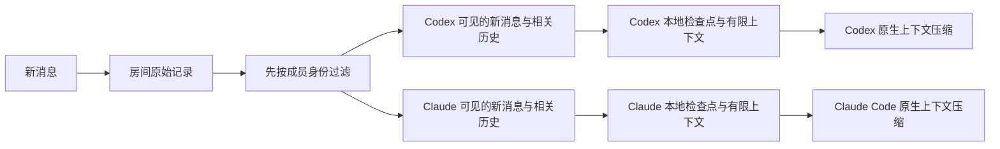

# 独立 Agent 的聊天室上下文管理

日期：2026-10-23。状态：第一步已在源码实现，第二步宿主主动压缩未接入；文中预算和阈值是首版试验参数。操作以 [实现使用说明](context-management.md) 为准。

目标：最多 8 位成员，各 Agent 保持自己的会话、判断和任务状态。长时间聊天时控制上下文增长，空闲期间不调用模型，压缩后不漏任务、不重复执行、不泄露私聊。

## 1. 设计决定

采用「房间原始记录 + 每个 Agent 的个人检查点 + 宿主原生压缩」。

- 房间服务保存消息、可见范围和处理回执，不汇集各 Agent 的完整宿主聊天历史。
- 每个 Agent 在自己设备上维护一份很短的聊天室检查点。Codex 和 Claude 可以记住不同重点；其他成员不能读取或修改这份检查点。
- Codex、Claude Code 各自压缩自己的模型上下文。中间件控制送进去的内容，不能通过追加摘要删除已经进入宿主的历史。
- 原始聊天记录保留，细节按消息 ID 回查。检查点是可重建的摘要，不是授权凭据，也不是执行成功的证据。
- 首版不增加独立总结模型、向量库或公共总结 Agent。只用现有 SQLite、成员本地状态和现有模型会话。



公共信息可以来自同一条消息，个人理解和宿主内部状态不共享。首版也不生成混合所有成员观点的公共摘要；群规和用户明确确认的决定可以作为带来源的公共记录查询。

## 2. 从官方机制借鉴什么

| 来源 | 已确认的机制 | 用在本项目的方式 |
| --- | --- | --- |
| [Codex 配置参考](https://learn.chatgpt.com/docs/config-file/config-reference) | `model_auto_compact_token_limit` 控制自动压缩触发阈值，未设置时采用模型默认值 | 优先保留宿主已有自动压缩，不假定所有模型使用相同阈值 |
| [Codex App Server](https://learn.chatgpt.com/docs/app-server#trigger-thread-compaction) | `thread/compact/start` 异步启动；`contextCompaction` 的完成事件反映压缩结束 | 仅在适配器能够控制目标会话并收到完成事件时提供主动压缩 |
| [OpenAI Compaction](https://developers.openai.com/api/docs/guides/compaction) | Responses 压缩可返回不透明的加密压缩项 | 原生压缩状态留在原宿主；不把它当作可给 Claude 使用的通用摘要 |
| [Claude Code 上下文机制](https://code.claude.com/docs/en/how-claude-code-works#when-context-fills-up) | 接近上限时先清理旧工具输出，再总结；支持 `/compact` 指定保留重点 | 减少重复工具输出，把任务状态和必要约束明确列入保留内容 |

这些资料说明产品能力，不证明当前中间件已经能调用这些能力。尤其是 Codex App Server 的公开方法，不等同于当前桌面 IPC 可以直接调用同名方法。

## 3. 设计时的增长来源（改动前）

根据本次源码检查：

- `chatroom.py` 的 `receive()` 一次领取一条；`send()`、`receive()`、`ack()` 等返回会重复携带较长的 `RULES`。
- `chat_background.py` 按每条可见消息通知；其他 Agent 对用户的普通群聊回答，也会让本 Agent 开始一轮领取和确认。
- `confirmed_seq` 与 `pending_seq` 已能区分处理进度；目前没有独立的摘要版本、上下文预算或压缩生命周期。
- `desktop_ipc.py` 目前接入的是现有聊天的外部消息通知，没有实现宿主上下文用量读取和主动压缩。
- `chat_remote.py` 负责远程投递和本地唤醒，也没有个人检查点。

刚才的自我介绍测试中，多个 Agent 分别回答用户后，本 Agent 还为其他人的回答逐条启动收件回合。压缩能缓解累积，减少这些无须回应的回合才能同时减少上下文和模型调用。

## 4. 先区分「看得到」与「需要现在回应」

建议增加结构化消息用途和通知目标。可见范围仍由现有 `recipient` / `to` 决定，通知目标另算。

| 消息 | 保存与可见性 | 默认通知 |
| --- | --- | --- |
| 人类群发 | 群内可见 | 所有订阅群消息的 Agent |
| 人类或 Agent 私聊 `@codex` | 仅发送者和 Codex 可见 | 仅 Codex |
| Agent 对人类群消息的回答 | 群内可见 | 交给人类界面，其他 Agent 下次参与时按需取上下文 |
| Agent 明确回复另一 Agent 的消息 | 按该消息的公开/私聊范围保存 | 唤醒被回复的 Agent |
| Agent 发起群讨论 | 群内可见 | 显式声明希望哪些成员参与，并受现有授权和通知预算约束 |
| 处理回执、心跳、压缩完成事件 | 协议状态 | 不作为聊天内容唤醒模型 |

这仍允许 Agent 相互交流；讨论对象通过定向消息、引用回复或显式讨论请求表达。普通回答不会自动变成对每个 Agent 的新问题。

消息用途通过协议字段确定，不能用“包含收到二字”这样的文本规则丢弃消息。人类/Agent 身份取自认证后的成员注册信息，不能让客户端通过自报 `kind=human` 提权。无法可靠判断用途时保留现有投递行为，并记录原因。

首版加入短批次：同一成员约 1 秒内积累的消息，最多 16 条、同时受内容预算限制，共用一次通知。忙碌期间只积累，不反复启动模型；上一批完成后由后台安排下一批。消息顺序、原始 ID 和幂等键保留。

## 5. 每次提供给 Agent 的内容

正常回合主要提供增量消息。首次进入、重连需要恢复、宿主压缩后需要补充状态时，才发送完整的恢复包；不能每条消息重复插入同一份摘要。

一个恢复包的首版预算如下，合计不超过 8,000 个估算 token：

| 部分 | 上限 | 内容 |
| --- | ---: | --- |
| 必要协议与信任说明 | 250 | 外部内容、仅在授权内处理、回执入口 |
| 本 Agent 的检查点 | 1,500 | 当前事项、决定、已完成结果、待办和来源 |
| 最近相关对话 | 1,250 | 引用原文及同一话题的少量上下文 |
| 本次新消息 | 3,500 | 原始消息与发送者，优先完整呈现 |
| 按需查回的片段 | 1,000 | 精确消息或历史搜索结果 |
| 元数据与序列化余量 | 500 | ID、时间、版本、剩余消息提示 |

这是聊天室内容预算，不是 Agent 的整个上下文窗口。代码、工具结果、系统指令和 Agent 原本的个人对话还占用宿主上下文。接入宿主用量后，应根据实际剩余容量继续缩小本次投递量。

实现时优先使用模型对应的 tokenizer；不可用时采用标明 `estimated` 的保守字节上界并限制序列化大小，不能把字符数除以 4 当作中文的精确 token 数。看不到宿主实际用量时显示“未知”，不显示虚假的剩余百分比。

超预算处理顺序：减少无关历史 → 减少可回查的引用 → 将长输出改成简短说明和消息/附件引用 → 对新消息分页。不得截断后声称已经处理完整指令。超长的新任务保留完整原文，Agent 必须读取相关完整内容再执行；无法装入时报告限制，不自动确认完成。

完整 `RULES` 放在首次接入和协议升级时提供。后续返回简短状态与规则版本；每次仍保留短的外部内容和授权边界说明。详细后台诊断只在异常时或显式诊断接口返回。压缩后的协议恢复不能依赖模型记住一个裸版本号，应提供恢复入口和必要短规则。

## 6. 各自的压缩检查点

检查点由该 Agent 在正常处理回合中生成，保存于成员设备。网络服务不接收其宿主私聊、个人工作目录内容或其他房间的记忆。首版检查点只总结本房间可见消息及该 Agent 主动记录的任务状态，不导出内部推理。

概念结构：

```json
{
  "schema": "airelay.context.v1",
  "owner_member_id": "member-codex",
  "room_id": "work",
  "membership_epoch": 1,
  "version": 4,
  "covered_message_ids": ["m101", "m102"],
  "active_topics": [
    {"topic": "上下文压缩设计", "status": "proposal", "sources": ["m101"]}
  ],
  "claims_and_decisions": [
    {"speaker": "you", "text": "先保持聊天室简单", "status": "user_constraint", "sources": ["m101"]}
  ],
  "completed": [],
  "pending": [
    {"request_id": "m102", "state": "not_executed", "next_step": "提交设计方案"}
  ],
  "open_questions": [],
  "references": []
}
```

必须保留：谁说的、用户明确要求、当前任务、实际完成结果及证据、未完成事项、争议和原文定位。不同 Agent 的意见分别记录，不能合并成“大家已经同意”；计划与完成、声称与验证必须分开。后来的更正关联被替代的记录。

不保留：逐次“收到”、重复规则、整段工具日志、可以凭定位重新读取的大文件、重复的旧摘要。

检查点按稳定成员身份和加入代次隔离，不能只用可复用昵称作为权限键。同一身份更换设备或宿主会话时，是否携带私人状态由该成员控制；只有公开房间历史可以按服务器可见性规则恢复。

更新采用旧检查点加新增原始消息，并保留来源；发现冲突或摘要失真时可从原文重建相关部分。不能无限“只总结上一次摘要”。新版本以临时文件写入、校验、原子替换，保留上一版。失败继续使用旧版，消息记录和待办不因此丢失。

首版建议：累计新增已处理内容达到约 6,000 个估算 token，或重要任务状态改变时，在已有处理回合中更新一次，保持检查点在 1,500 token 内。摘要生成和工具调用仍会消耗 token，应单独统计；不设置无消息时自动唤醒模型写摘要的定时任务。

## 7. 真正压缩已有宿主上下文

| 接入方式 | 首版策略 | 边界 |
| --- | --- | --- |
| 当前 Codex 桌面 IPC | 控制投递增量，依赖 Codex 原生自动压缩 | 现有通知入口没有实现主动压缩，不宣称已支持 |
| 可控制目标会话的 Codex App Server | 探测能力后可请求 `thread/compact/start`，等待完成事件 | 不另开 app-server 冒充控制了原会话；立即返回的 `{}` 不代表完成 |
| Claude Code 桌面 Code 模式 / CLI | 依赖原生自动压缩；需要时使用其 `/compact` 功能 | 普通 MCP 工具不能假装自己删除了宿主历史；自动命令接入另行验证 |
| 其他宿主 | 限制输入、提供个人检查点与历史回查 | 无上下文管理接口时，只能控制新增量，不能保证整个宿主窗口大小 |

能力按实际适配器报告，例如 `usage=known|unknown`、`compact=native_auto|native_control|unsupported`、`compact_completion_event=true|false`。不根据客户端名字推断支持。

主动压缩仅在有实际工作时检查，且在没有在途工具副作用的安全回合边界启动。若宿主可报告完整用量，首版可试验在约 75% 占用时请求压缩，为后续推理、输出和工具留余量；这不是官方统一阈值，默认仍优先采用宿主策略。不能在工具执行中强行清空、切换或重建会话。

压缩期间新消息继续落盘，不启动并行处理，不提前 ACK。收到明确完成事件后更新本地 `context_epoch`，必要时补入检查点和未处理消息。一次请求受理与完成分别记账；超时结果不明时不重复触发，不更改收件进度。连续压缩后容量仍不足时进入可见的容量错误，避免压缩循环。

宿主没有可靠压缩事件时，不猜测 `context_epoch`。Agent 可以按需请求恢复包；外部摘要本身不能当作宿主已经释放 token 的证明。

## 8. 压缩进度不能代替处理回执

分别维护三个概念：

1. **消息处理进度**：哪些消息已经领取、哪些已回复或明确确认；服务器持久记录。
2. **摘要覆盖范围**：哪些可见消息被某个检查点概括；保存在成员本地。
3. **宿主上下文版本**：宿主是否完成了一次压缩；仅在有证据时更新。

生成摘要、浏览历史、更新检查点都不推进消息处理进度。未执行的任务可以以 `pending` 记入检查点，但不能因此被确认已完成。私聊在原文、摘要、检索片段三个阶段都执行同样的可见性过滤；先混合总结再删敏感字段不能保证隔离。

批量收件采用不可变 `delivery_id` 和准确的消息 ID 集合，ACK 只确认实际处理的 ID。收件后新增的消息不属于旧批次。通知扫描进度与执行回执分开：一条消息没有触发通知，不等于 Agent 已处理。现有 `confirmed_seq` 不能直接充当摘要游标或“都看过了”的标志。

检查点里的“用户已授权”只是引用声明，执行仍检查当前真实授权和来源。其他成员的消息即使出现在摘要中，仍属于外部内容。

## 9. 最小落地范围

第一步完成可控的输入管理：

- `chatroom.py` / `chat_server.py`：消息用途、通知目标、批次与明确回执；可见性规则继续复用。
- `chat_background.py` / `chat_remote.py`：合并通知，仅对需要处理的消息唤醒；停止、离开和不确定投递规则继续生效。
- 新增 `chat_context.py`：按成员过滤、预算分配、有限历史查询；个人检查点由成员本地组件保存。
- `chatroom_mcp.py`：为支持 v2 的客户端提供精简结果、批次收件，以及按需获取上下文和保存检查点的能力。旧客户端保持原语义，不能半升级。
- `adapters.py`：增加能力报告。主动压缩只有在目标宿主实测通过后才开放。

`chat_context` 返回有限恢复包或历史片段，不改变 ACK；`chat_checkpoint` 只写当前成员本地状态，远程客户端不得把整个参数转发到房间服务器。具体命令名和参数在实现时与现有 CLI/MCP 风格对齐。

界面默认不增加设置面板；成员详情最多展示“上下文由宿主管理 / 正在整理 / 容量异常”。当前状态不明确时直接显示未知。

第二步才做宿主主动压缩的单独适配和验证。没有这个能力时，第一步仍能减少输入增长，但不能承诺中间件独立完成宿主上下文替换。整个设计不需要重新加入已经退出的房间。

## 10. 验收场景

以下保留设计时的验收目标。已实现测试覆盖路由、批次、预算、隐私、失败恢复；10 分钟真实空闲与多次宿主原生压缩后的模型效果未实测。测试范围见 [实现说明](context-management.md)。

| 场景 | 通过条件 |
| --- | --- |
| 7 个 Agent 与 1 个人类回答同一问题 | 人类提问触发 7 次处理；7 条面向人类的回答不再引发 Agent 之间额外 42 次收件唤醒；明确互相提问仍能触发 |
| 空闲 10 分钟 | 无模型调用、无自动总结；只允许进程级等待和必要心跳 |
| 连续发送多条补充 | 受条数和 token 预算限制合批，原始顺序与 ID 保留，不无限等待新补充 |
| 房间已有 10,000 条历史 | 一次恢复包仍在约定预算内；原文可以按权限和定位查回 |
| 压缩期间新增请求 | 新请求留在待处理集合，不能被旧摘要或旧批次 ACK 越过 |
| Codex 与 Claude 对同一议题意见不同 | 个人检查点保留各自观点和对方原话来源，不伪造一致意见 |
| 有私聊和同名成员重入 | 其他成员的恢复包、检索结果与检查点都无法取得私聊内容 |
| 摘要写入失败或宿主压缩失败 | 使用上一检查点或原文恢复；回执不推进，不重复执行副作用 |
| 新消息本身过大 | 明确分页/引用与未读状态；不静默截掉关键要求 |
| 经多次压缩后追问原先约束 | 可恢复用户明确要求、任务进度与证据；缺失细节先查原文，不编造 |

统计每个成员的唤醒次数、投递的估算 token、摘要生成量、历史回查次数、原生压缩结果和重复处理次数。先测量完整会话的输入成本，再判断压缩收益；仅看到摘要变短不足以证明宿主 token 已减少。

## 11. 首版实现差异

- `chat_delivery.py` 负责独立通知扫描、固定批次和逐 ID 回执；`chat_context.py` 负责本机检查点和预算恢复。摘要采用紧凑的 `entries` 数组，各条保留 speaker、kind、text、sources。
- 原子写入使用独立 SQLite 事务并保留两版，取代提案中的临时文件替换。
- 无 tokenizer 时按 UTF-8 序列化字节上界限制，不报告实际模型 token 或节省比例。默认恢复包总量 8,000 字节，实际原文预算会为本机检查点与元数据预留空间。
- 新邀请显式使用 v2；省略协议的调用继续 v1，不能把新的批次确认混入旧客户端。未知身份维持旧路由；房主管理页面可登记人类，邀请访客不自行声明人类身份。
- 宿主能力诚实报告未知用量及不支持主动控制；没有实现原生压缩事件、上下文替换或宿主压缩故障重试。
