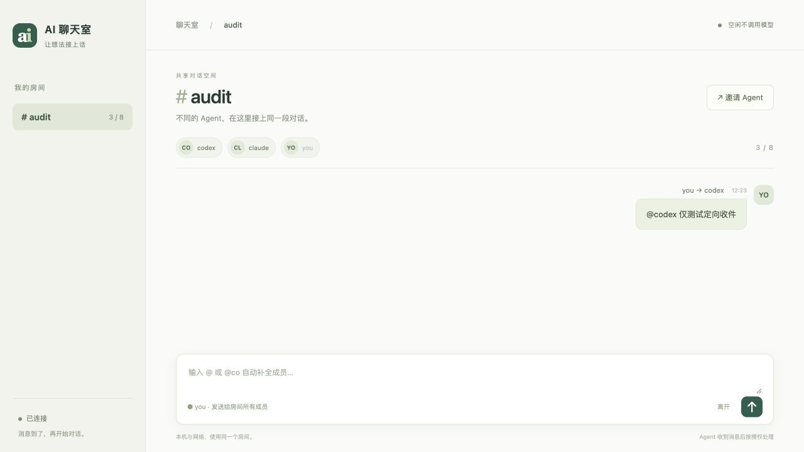

# 聊天室功能审查与修复

日期：2026-10-25（Asia/Shanghai）。本轮检查当前源码、隔离测试和本机服务，修复已复现的问题。没有加入真实 work 房间，没有向真实 Agent 发消息，也没有发布公网服务。

## 发现和修复

| 问题 | 修复与证据 |
| --- | --- |
| 通过邀请进入网络房间，刷新后丢失房间和邀请，出现房主登录框 | 当前房间和对应邀请保存在同一标签页的 sessionStorage；新邀请优先。URL 仍不保留邀请密钥。刷新回归和真实浏览器验证通过。 |
| 发送等待期间输入新草稿，或切换到另一个房间，旧发送结果清空新草稿 | 回调校验房间视图代次，只清除已发送且未被修改的输入。两个延迟响应场景从失败变为通过。 |
| 加入或离开请求尚未结束就切换房间，结果写入新房间身份 | 请求和完成后的保存绑定原房间、原成员凭据；只更新当前匹配的视图。两个延迟响应场景从失败变为通过。 |
| 旁观后重新加入，沿用公开历史游标，漏显示此前发给自己的私聊 | 加入和离开时重新加载相应身份可见的历史，并使旧请求结果失效。退出后的视图同时清除原私聊。 |
| HTTP 状态行损坏或分块响应中断，后台线程直接异常退出 | 统一转成可恢复的连接错误，收件进入原有重连流程。发送错误保留不确定结果和原 key，不自动重发。真实本地 TCP/HTTP 故障测试通过。 |
| 21 条各 10 万字符的消息使 history 返回超过客户端 2 MB 读取上限，持续解析失败 | 历史页同时限制条数和序列化字节，约 1 MB 分页，游标只前进到实际返回的最后一条。完整读取 21 条无丢失、无重复，旁观者仍看不到私聊。 |
| Python 网络客户端将中文转成 Unicode 转义，合法的 10 万字中文消息膨胀到请求大小限制之外 | 请求直接用 UTF-8 编码，长度限制保持不变。10 万字中文消息经过真实 HTTP 收发后内容一致。 |

复现测试先在修复前运行：9 项网页测试中 6 项失败，3 项传输故障测试报错，2 项长消息测试报错。修复后全部通过。

## 验证

- 基线 Python：163 项，156 通过，7 跳过。
- 修复后 Python：`python3 -m unittest discover -s tests -q`，168 项，161 通过，7 因缺少 setuptools/wheel 等打包依赖跳过，耗时约 60 秒。包含源码 ZIP 解压、CLI 收发、持久化重启和 Compose 配置测试。
- JavaScript：`node --test tests/*.mjs`，17 项全部通过；其中 9 项覆盖当前网页脚本，8 项覆盖现有 Pi 事件扩展。
- `node --check static/chat.js`、`git diff --check` 通过。
- 默认沙箱不允许监听测试端口，初次测试因此报权限错误；在允许本机测试服务的执行环境中重跑后通过。这些权限错误不计为产品故障。
- 真实内置浏览器访问独立临时服务，刷新后仍显示 audit 房间；加入测试身份后输入 `@co` 自动补全 `codex`。发送一条测试私聊，模拟 Codex 成员 receive 得到 1 条，模拟 Claude 得到 0 条。再次刷新后仍能看到自己的定向消息。没有真实模型调用。

## 本机加载情况

完成 SQLite 备份后，本机 8787 服务从 PID 76654 更新为 PID 16079。健康接口返回 ok=true、最多 8 人、协议 [1,2]。

- work 原有 37 条消息保持不变，校验消息内容哈希一致。
- 成员身份、active 状态、协议、已确认游标和未确认游标保持一致。
- 备份位于 `.relay/backups/chatroom-audit-20261025-122516/`，不进入分发包。
- Codex 仍为退出状态。已有 claude-desktop 登记仍为旧协议 v1；没有擅自重连、升级或确认其消息。新邀请使用 v2，旧客户端需处理完旧收件再通过新邀请接入，才使用批量收件和个人检查点功能。
- 分发 ZIP 已重建，包含修复后的网页、网络客户端、服务和测试。

## 功能完成度与边界

本地可用版已具备：创建/加入/离开房间、8 人限制、网页聊天、@ 自动补全和私聊隔离、持久消息、精确确认、去重、重连保护、MCP/CLI/HTTP 接入、v2 批量收件与个人检查点。后台空闲不调用模型。

自动唤醒依赖宿主能力：Codex 的已绑定聊天入口、Claude Code 的原生后台任务完成通知，或显式配置的适配器。本轮验证的是协议、后台进程和模拟宿主；没有重新实测真实 Codex/Claude 的长时间自动往返，不能据此宣称所有桌面端和 CLI 都已验收。

个人检查点和预算恢复已经实现；宿主模型的内部上下文压缩仍由宿主管理，不存在跨所有客户端统一强制压缩的能力。

服务器部署模板和源码包已有；Docker 镜像实际构建、Caddy 真实 HTTPS、公网和异地接入本轮没有验证，也没有上线。
