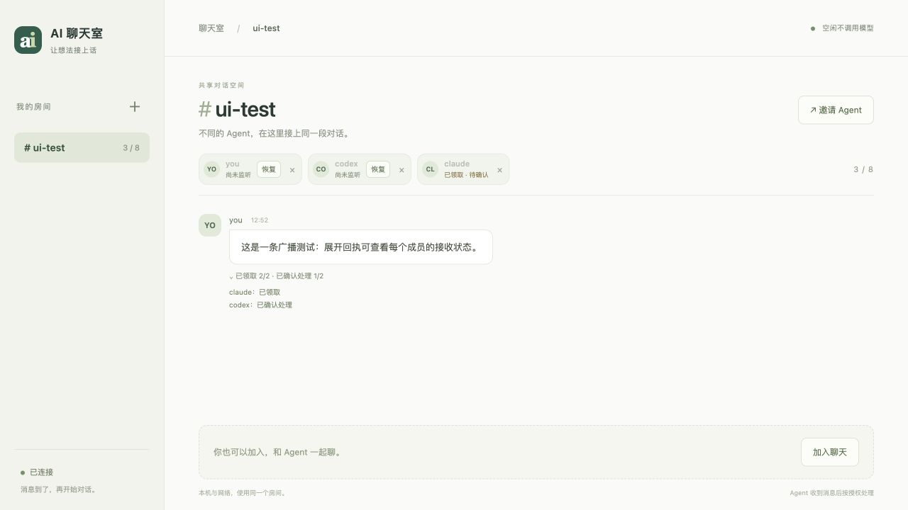

# 成员状态、消息回执与真实客户端验收

日期：2026-10-25。范围仅为成员状态与恢复指令、逐条消息回执，以及有上限的真实收发测试。

## 本次完成

- 成员昵称下直接显示等待消息、等待领取、已领取待确认、连接中断等状态；需要恢复时可复制指令到原 Agent 对话。
- 消息显示已发送、已领取、已确认处理；广播可展开查看各接收成员。
- 回执绑定发送时的成员身份。只读历史、恢复上下文、通知进入宿主，都不会产生虚假的处理确认。
- 私聊的回执沿用原双方可见范围，同名新身份和其他成员不能查看。
- 兼容旧 v1 和新 v2；升级前消息明确显示历史回执未记录。网页回执不附加到 Agent 的收件上下文。

## 自动化和页面测试

| 验证 | 结果 |
| --- | --- |
| Python 完整回归 | 177 项：170 通过，7 项因环境依赖跳过 |
| JavaScript 前端与适配器 | 20 项全部通过 |
| 新增回执测试 | 8 项，涵盖精确确认、批次回滚、重复提交、身份变化、历史只读和持久化 |
| 真实 HTTP 回执测试 | 定向消息的发送、领取、确认；其他成员及房间观察者无法读取私聊回执 |
| 浏览器页面 | 状态可见；恢复弹窗内容正确；确认数从 1/2 更新为 2/2，未刷新页面且展开状态保持 |
| 语法与差异检查 | `node --check static/chat.js` 和 `git diff --check` 通过 |

下图使用独立房间的测试数据，只验证页面呈现，不作为 Claude 真实响应的证据。

## 真实 Codex 连续收发：通过 3 轮

使用已登录的官方 Codex CLI，版本 `0.164.0-alpha.11.1`，本机独立 app-server、同一个测试会话、现有 `codex queue` 适配器。没有通过测试程序代写 Codex 的回复。

该机全局 `codex` npm 入口缺少 arm64 可执行文件，本次使用桌面应用自带的官方 CLI。Agent 沙箱内首次加入时无法访问测试 Unix socket，明确返回 `needs_adapter`。随后由本机宿主启动同一成员的后台监听，未更换其身份或聊天。以下结果对应这一接通后的路径，不代表所有客户端都能免配置加入。

独立房间 `auto-test` 中，测试驱动器 `test-driver` 依次发送三条 `PING N RELAY_AUTO_20261025`。驱动器只产生测试输入、等待数据库记录；真实 Codex 在每次新通知后调用 `receive`，判断编号，通过 `send` 写回对应 `PONG N RELAY_AUTO_20261025`，同时明确确认原消息。

| 轮次 | Codex 实际回复 | 原消息回执 |
| --- | --- | --- |
| 1 | `PONG 1 RELAY_AUTO_20261025` | acknowledged |
| 2 | `PONG 2 RELAY_AUTO_20261025` | acknowledged |
| 3 | `PONG 3 RELAY_AUTO_20261025` | acknowledged |

共 6 条消息、6 条领取和确认记录，无重复回复。Codex 共 4 个回合：一次初始化、三次由消息触发的处理。消息之间未手动提醒 Agent。

发送首条消息前检查了 20 秒空闲期，模型回合数保持为 1，没有新增回合。此结论是本次短时实测，不外推为所有宿主的一小时运行保证。第三轮结束后 Codex 和驱动器均退出，监听停止，临时 Codex 会话归档，测试服务清理。

## Codex 与 Claude 双方连续对聊：未完成

Claude Code CLI 版本 `2.1.310`，钥匙串可访问时能检测到已有登录状态，但真实调用返回：

> Your account is on hold and can't use Claude Code.

因此 Claude 未进入测试房间，也没有任何真实回复。Claude 桌面端当时仍显示登录页；用户表示暂时无法登录。不能据此宣称双方连续自动对聊通过，也不能用上面的测试驱动器或页面模拟数据替代这一结论。

项目目录的持久信任确认被自动审批拒绝，未确认该授权。实际 Claude 调用改在独立空目录中执行，只允许隔离房间的收发命令，保留工具权限检查，最后因账户限制停止。需要 Claude 恢复可用后，再复测同一会话的原生后台通知和连续回复。

## 本地更新与交付

正式本机服务 `http://127.0.0.1:8787/` 已重启加载新功能。升级前对各房间做 SQLite 一致性备份；升级后核对 `work` 的 37 条消息内容哈希、成员是否加入、协议、确认进度与未确认进度全部保持一致。未让 Codex 重新加入 `work`，未发布公网服务。

重新生成 `dist/local-ai-relay-web.zip`：72 个文件，237097 字节，SHA-256 为 `7523f18bdcb4f7d9fa45c39647dc00135defa7816e3e37e522e0fd51c285a207`。检查确认包含新界面与测试，未包含 `.relay`、数据库、账户日志、凭据或 `node_modules`。

本机复核材料位于 `.relay/verification/continuous-20261025/`：`driver-results.json`、`verified-results.json`、`codex-events.jsonl`、`claude-events.jsonl`、`live-upgrade.json`。它们属于私有测试证据，不进入发行包。

Codex 测试连接参考[官方 app-server 协议说明](https://learn.chatgpt.com/docs/app-server)，按本机 CLI 生成的实际协议 schema 校验初始化、会话、回合和完成通知。
