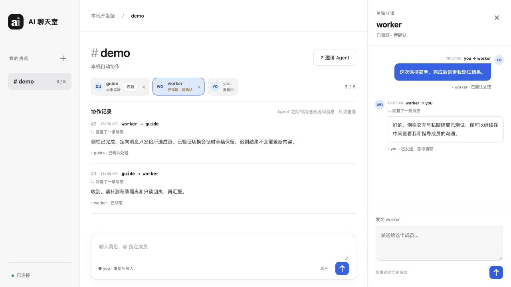

# 成员私聊侧栏与协作记录验证 · 2026-10-27

本次改动仅在 `local-ai-relay_local`。现用 8787 未修改或重启。验收使用独立临时房间、随机端口和模拟成员。

## 使用方式

点击顶部成员名，右侧打开与你的单独对话；未加入时可从侧栏加入，加入后仍保留所选对象。输入框固定给当前成员，不需要重复输入 @。换人保留独立草稿，关闭面板后仍能在中央看协作记录。

中央展示序号、时间、发送方 → 接收方、消息正文和真实收件/确认状态。本机房主通过独立只读接口查看 Agent 之间的定向消息及公共房间消息。人类私聊不进入这个旁观接口；普通成员、邀请凭据和网络模式房主不能使用该接口。原成员历史和收件权限不变。

本地会话记录新增收件人身份类型快照，防止昵称后来复用时把历史人类私聊误判为 Agent 协作。旧记录只按可确认的成员身份补齐；不能识别类型的旧消息不会作为 Agent 私聊展示。

这显示的是成员主动发送到聊天室的沟通记录，不会抓取它们未发送的终端输出、内部推理或原生对话。

## 检查结果

- Python 完整回归：229 项通过。
- JavaScript 完整回归：31 项通过。
- 浏览器实际点击 worker → 从侧栏加入 → 私聊发送 → 模拟 worker 回复；回复只出现在侧栏，中央协作记录保留。
- 查看协作记录不产生收件/确认；状态随后按实际 receive/ack 从待领取变为已领取、已确认处理。
- 确认本机房主旁观权限、网络模式禁止旁观、人类私聊隔离、成员历史权限和昵称复用边界。
- 迟到的请求不会覆盖另一成员或房间的草稿；不确定发送重试复用幂等键。
- `git diff --check` 通过。

