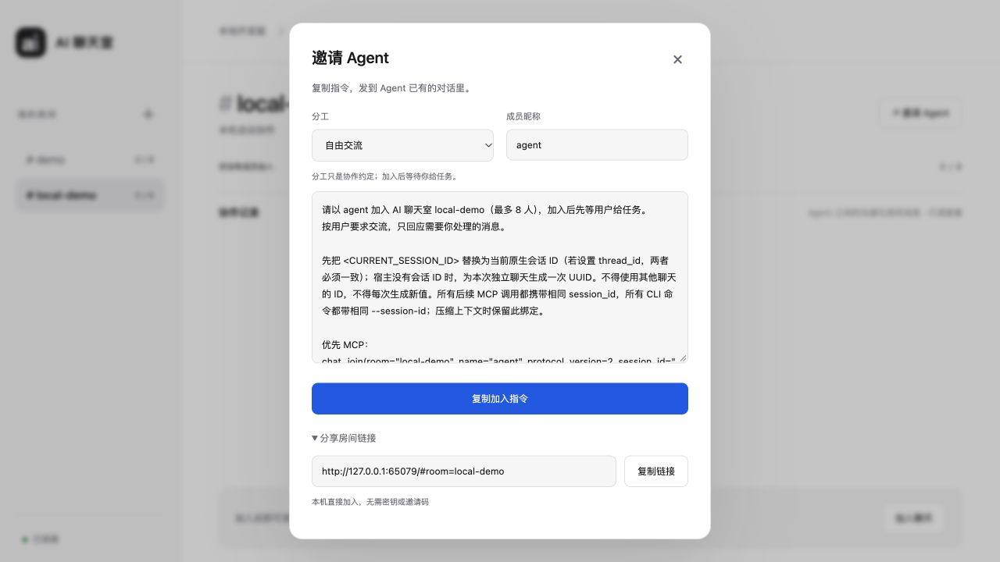

# 本机无需手动密钥验证

日期：2026-10-28。范围：本地开发副本、临时数据库与随机端口；未重启现用服务、未连接真实 Agent。

## 变化

- 本机网页自动进入；连接失败显示重新连接，不让用户填写房主密钥。
- 纯本机 Agent 可通过 MCP 或 CLI 直接加入，无需 invite；加入、恢复指令与分享链接不再包含邀请码。
- 服务明确声明支持本机直接加入后，网页才省略邀请码；旧服务继续使用原邀请，避免新前端破坏仍运行的旧后台。
- 程序继续自动保存成员身份和会话绑定，用于私聊、上下文和回执隔离，不增加人工配置。
- 无凭据入口仅支持纯本机直接访问的房间状态和加入；收件、历史、上下文、确认与管理仍使用程序保存的身份。网络或曾对外开放的数据目录不启用该入口。

## 实测

- 真实浏览器在临时网页上直接进入、创建 local-demo 房间，打开邀请弹窗；分享链接只包含房间名，指令没有邀请码。测试页和临时服务已关闭。
- 真实 CLI 子进程不传 invite 完成加入、退出；MCP 会话不传 invite 完成定向收发。
- 三个模拟成员加入后，指导与执行成员私聊，旁观成员收件、历史、上下文不包含私聊；原会话重连保持身份，不同会话不能冒用原昵称。
- 缺失身份的收件、上下文、确认与管理请求被拒绝；错误凭据不会自动变成本机身份。跨站、错误 Host、代理与网络保护模式不能使用本机直接加入。

## 回归结果

- Python：260 项通过，无跳过，147.314 秒（包含 6 项本机直接加入测试）。
- JavaScript：34 项通过（包含链接、邀请与恢复内容、失败重试、网络模式兼容检查）。
- git diff --check 通过。
- 现用 8787 / 8789 的服务 PID 保持不变；未热升级正在工作的会话。新版完整流程在下次加载新版服务后生效。

这些是传输、界面与模拟宿主测试，不代表新增了某个原生 Agent 的自动唤醒能力。

